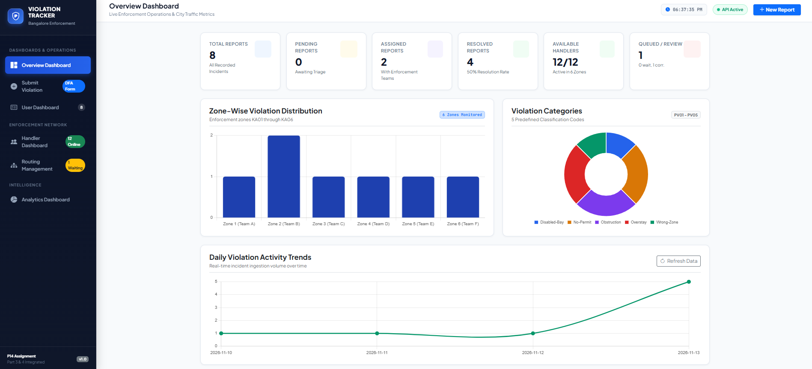
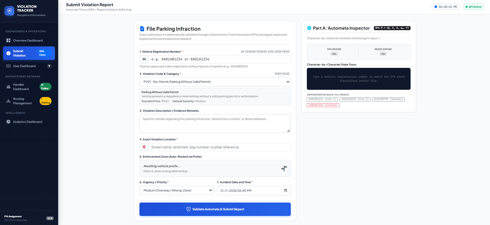
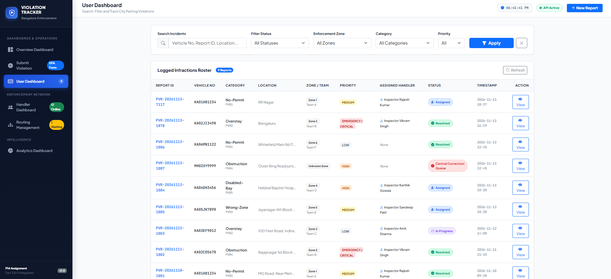
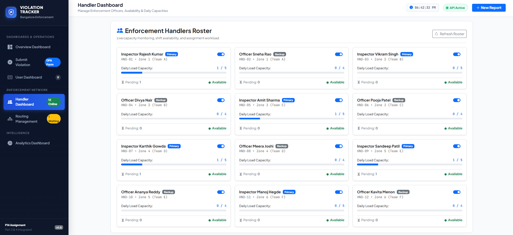
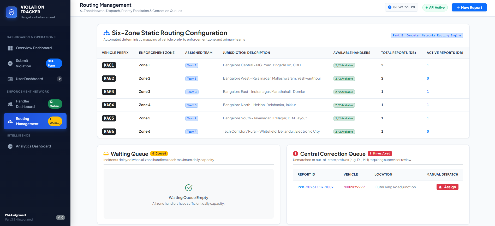
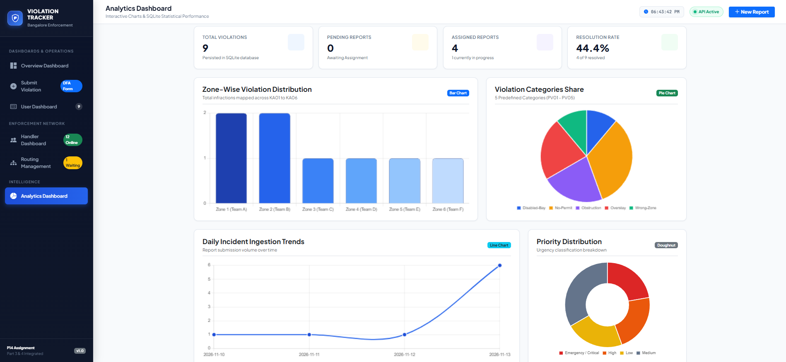

# 🚗 Parking Violation Tracker – Project P14

A full-stack **Parking Violation Reporting and Enforcement Management System** integrating **Automata Theory, Computer Networks, and Full Stack Web Development**.

The application validates vehicle registration numbers using **Deterministic Finite Automata (DFA) and Regular Expressions**, assigns enforcement teams through **prefix-based routing and priority queueing**, and provides interactive dashboards for managing and analysing parking violations.

**GitHub Repository:** [Parking-Violation-Tracker](https://github.com/Nagaraj-Gouda/Parking-Violation-Tracker)

---

## 📌 1. Project Overview

Parking Violation Tracker is designed to simplify parking violation reporting, validation, assignment, monitoring, and enforcement.

### Main Objectives

- Vehicle registration validation using DFA and Regular Expressions.
- Automatic violation classification.
- Zone-based enforcement team assignment.
- Priority-based dispatch and waiting queue management.
- Handler availability and workload management.
- Violation tracking and status updates.
- Interactive analytics and reporting dashboards.

### Academic Concepts Integrated

- **Part A:** Automata Theory Integration.
- **Part B:** Computer Networks Integration.
- **Part 3:** Frontend and Web Application Development.
- **Part 4:** Testing and Integration.

---

## 📸 2. Project Screenshots

### 1. Overview Dashboard



### 2. Submit Violation



### 3. User Dashboard



### 4. Handler Dashboard



### 5. Routing Management



### 6. Analytics Dashboard



---

## ✨ 3. Key Features

### A. Automata Theory Integration

Implemented in `backend/validation.py`.

**Vehicle Registration Validation**

- Uses a Deterministic Finite Automaton (DFA).
- Validates Indian vehicle registration numbers character by character.
- Uses accepting and dead/trap states.
- Compares DFA validation results with Python Regular Expression validation.

**Vehicle Registration Pattern**

```regex
[A-Z]{2}[0-9]{2}[A-Z]{1,2}[0-9]{4}
```

**DFA Mathematical Model**

```text
M = (Q, Σ, δ, q0, F)
```

Where:

- `Q` – Set of states.
- `Σ` – Input alphabet.
- `δ` – Transition function.
- `q0` – Initial state.
- `F` – Set of final states.

**Violation Code Validation**

```regex
PV[0-9]{2}
```

The application rejects malformed vehicle numbers and invalid violation codes.

### B. Computer Networks Integration

Implemented in `backend/routing.py`.

**Prefix-Based Routing**

The system uses vehicle registration prefixes to determine enforcement zones and assigned teams.

| Prefix | Enforcement Zone | Team | Coverage Area |
|---|---|---|---|
| KA01 | Zone 1 | Team A | Bangalore Central |
| KA02 | Zone 2 | Team B | Bangalore West |
| KA03 | Zone 3 | Team C | Bangalore East |
| KA04 | Zone 4 | Team D | Bangalore North |
| KA05 | Zone 5 | Team E | Bangalore South |
| KA06 | Zone 6 | Team F | Tech Corridor |

**Priority-Based Dispatch**

Reports are processed according to the following priority:

1. Emergency / Critical
2. High
3. Medium
4. Low

**Additional Routing Features**

- Primary and backup handler assignment.
- Automatic handler failover.
- Daily handler workload limits.
- Waiting queue for reports when handlers are unavailable.
- Central correction queue for unrecognized vehicle prefixes.
- Prevention of duplicate active incident assignments.

### C. Frontend Web Application

Developed using React and Vite.

The application contains six main sections:

| Dashboard | Features |
|---|---|
| Overview Dashboard | Summary cards, violation statistics, charts and recent reports |
| Submit Violation | Violation submission, vehicle validation and routing preview |
| User Dashboard | Search and filter submitted violation reports |
| Handler Dashboard | Handler availability, assignments and status updates |
| Routing Management | Zone routing, waiting queue and correction queue |
| Analytics Dashboard | Interactive charts and database-driven statistics |

---

## 🛠️ 4. Technology Stack

| Category | Technologies |
|---|---|
| Frontend | React 18, JavaScript, HTML5, CSS3 |
| Build Tool | Vite 6 |
| UI Framework | Bootstrap 5.3, Bootstrap Icons |
| Routing | React Router DOM 6 |
| Charts | Chart.js 4, react-chartjs-2 |
| Backend | Python 3.13, Flask 3.1 |
| API | Flask REST APIs, Flask-CORS |
| Database | SQLite3 |
| Testing | Pytest 8.3.4 |
| Version Control | Git and GitHub |

---

## 📂 5. Project Directory Structure

```text
Parking-Violation-Tracker/
│
├── backend/
│   ├── app.py
│   ├── database.py
│   ├── validation.py
│   ├── classification.py
│   ├── routing.py
│   ├── requirements.txt
│   ├── parking_tracker.db
│   └── tests/
│       └── test_tracker.py
│
├── frontend/
│   ├── src/
│   │   ├── components/
│   │   │   ├── Navbar.jsx
│   │   │   ├── Sidebar.jsx
│   │   │   ├── StatisticsCard.jsx
│   │   │   ├── ReportTable.jsx
│   │   │   ├── StatusBadge.jsx
│   │   │   ├── LoadingIndicator.jsx
│   │   │   └── ReportDetailModal.jsx
│   │   │
│   │   ├── pages/
│   │   │   ├── OverviewDashboard.jsx
│   │   │   ├── SubmitReportPage.jsx
│   │   │   ├── UserDashboard.jsx
│   │   │   ├── HandlerDashboard.jsx
│   │   │   ├── RoutingDashboard.jsx
│   │   │   └── AnalyticsDashboard.jsx
│   │   │
│   │   ├── services/
│   │   │   └── api.js
│   │   │
│   │   ├── App.jsx
│   │   ├── App.css
│   │   └── main.jsx
│   │
│   ├── package.json
│   ├── package-lock.json
│   ├── vite.config.js
│   └── index.html
│
├── screenshots/
│   ├── overview.png
│   ├── submit-violation.png
│   ├── user-dashboard.png
│   ├── handler-dashboard.png
│   ├── routing-management.png
│   └── analytics.png
│
├── README.md
├── TESTING.md
└── .gitignore
```

---

## ⚙️ 6. Installation and Setup

### Prerequisites

Install the following software:

- Python 3.10 or higher.
- Node.js 18 or higher.
- npm.
- Git.
- Visual Studio Code (recommended).

### Step 1: Clone the Repository

Open PowerShell or the VS Code terminal.

```powershell
git clone https://github.com/Nagaraj-Gouda/Parking-Violation-Tracker.git
```

Navigate to the project directory:

```powershell
cd Parking-Violation-Tracker
```

### Step 2: Set Up the Backend

Navigate to the backend folder:

```powershell
cd backend
```

Create a Python virtual environment:

```powershell
python -m venv venv
```

Activate the virtual environment:

```powershell
.\venv\Scripts\Activate.ps1
```

Install backend dependencies:

```powershell
python -m pip install -r requirements.txt
```

### Step 3: Set Up the Frontend

Open a second terminal at the project root directory.

Navigate to the frontend folder:

```powershell
cd frontend
```

Install frontend dependencies:

```powershell
npm install
```

---

## ▶️ 7. Running the Application

The application uses two development servers.

### Terminal 1: Start the Flask Backend

From the project root:

```powershell
cd backend
```

Activate the virtual environment:

```powershell
.\venv\Scripts\Activate.ps1
```

Start the backend:

```powershell
python app.py
```

**Backend URL:**

```text
http://127.0.0.1:5000
```

**Health Check:**

```text
http://127.0.0.1:5000/api/health
```

### Terminal 2: Start the React Frontend

Open another terminal at the project root:

```powershell
cd frontend
```

Start the frontend:

```powershell
npm run dev
```

**Frontend URL:**

```text
http://localhost:5173
```

Open the frontend URL in your browser to access the application.

**Note:** The Vite development server is configured to proxy API requests to the Flask backend.

---

## 🧪 8. Running Automated Tests

The backend includes automated tests using Pytest.

Run the following commands from the project root directory:

```powershell
$env:PYTEST_DISABLE_PLUGIN_AUTOLOAD = "1"
python -m pytest backend/tests/test_tracker.py -v
```

The project test suite is documented as containing 20 automated test scenarios.

**Expected test summary:**

```text
20 passed
```

For detailed test descriptions, refer to:

[TESTING.md](TESTING.md)

---

## 🔗 9. REST API Reference

The backend provides REST API endpoints for communication between the frontend and backend.

| Method | Endpoint | Description |
|---|---|---|
| GET | `/api/health` | Check backend health |
| GET | `/api/categories` | Retrieve violation categories |
| POST | `/api/validate/vehicle` | Validate vehicle registration |
| GET | `/api/reports` | Retrieve violation reports |
| POST | `/api/reports` | Submit a violation report |
| GET | `/api/reports/<id>` | Retrieve incident details |
| PUT | `/api/reports/<id>/status` | Update violation status |
| POST | `/api/reports/<id>/reassign` | Reassign an incident |
| GET | `/api/handlers` | Retrieve handler information |
| PUT | `/api/handlers/<id>/availability` | Update handler availability |
| GET | `/api/zones` | Retrieve enforcement zones |
| GET | `/api/analytics` | Retrieve analytics data |

---

## 🚨 10. Violation Classification

The application supports five predefined violation categories.

| Code | Category | Fine | Default Priority |
|---|---|---:|---|
| PV01 | No-Permit | ₹500 | Medium |
| PV02 | Overstay | ₹300 | Low |
| PV03 | Wrong-Zone | ₹750 | Medium |
| PV04 | Obstruction | ₹1,000 | High |
| PV05 | Disabled-Bay | ₹1,500 | Emergency / Critical |

---

## 👥 11. Team Members

This project was developed collaboratively by:

1. **Nagaraja Manjunath Gouda**
2. **Varun CT**
3. **Veeresh RP**
4. **Nataraj Sagar J**
5. **Vishal Waghmare**

---

## 🎯 12. Learning Outcomes

Through this project, we explored the practical application of:

- Automata Theory through DFA and Regular Expressions.
- Computer Networks through prefix-based routing and queue management.
- Full Stack Development through React, Flask and SQLite.
- REST API development and frontend-backend integration.
- Database management and data persistence.
- Software testing using Pytest.
- Version control and GitHub.

---

## 🚀 13. Future Enhancements

Possible future improvements include:

- Online deployment of the application.
- User authentication and role-based access.
- Image upload for parking violation evidence.
- Interactive geographical maps for enforcement zones.
- Email or SMS notifications.
- Advanced reporting and analytics.

---

## 📌 14. Project Repository

**GitHub Repository:**

[https://github.com/Nagaraj-Gouda/Parking-Violation-Tracker](https://github.com/Nagaraj-Gouda/Parking-Violation-Tracker)

**Project Status:** Developed as an academic full-stack project. The application currently runs locally and has not yet been deployed as a live website.

---

⭐ If you find this project interesting, consider giving the repository a star!

**Built with dedication as part of the Academic P14 Project.**